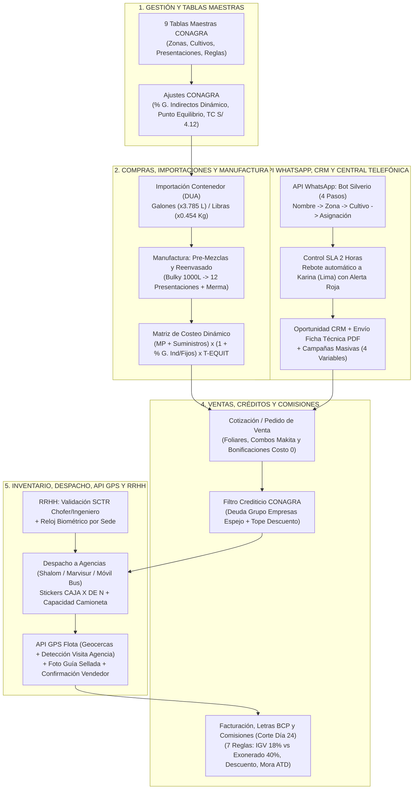

# Manual de Usuario y Casos de Uso — Sistema Integral CONAGRA

> [!IMPORTANT]
> **Acerca de este Manual de Operación Corporativo**
> Este documento constituye la guía oficial, técnica y operativa del **Sistema Integral CONAGRA**, desarrollado a medida para integrar en una sola plataforma unificada todas las áreas de negocio de **CONAGRA**: Nutrición Vegetal y Fertilizantes Foliares, Sistemas de Riego Tecnificado, Representación Oficial de Maquinaria y Herramientas **Makita**, Importaciones y Distribución Nacional a través de agencias y tiendas propias (*Piura, Huaura, Casma, Imperial, Huancayo y Planta Central Lima*).
> 
> En este documento se detalla el Proceso Macro (End-to-End), el manual operativo de cada subproceso, la guía exhaustiva campo por campo de cada formulario y 8 Casos de Uso reales para demostración ante la directiva y clientes.

---

## ÍNDICE GENERAL

1. **PARTE I: ARQUITECTURA Y PROCESO MACRO (Punta a Punta)**
   - 1.1 Objetivos y Beneficios del Sistema CONAGRA
   - 1.2 Mapa del Ecosistema Operativo de CONAGRA
   - 1.3 Diagrama de Flujo Macro en 5 Fases
   - 1.4 Resumen Ejecutivo de Interacción entre Áreas

2. **PARTE II: SUBPROCESOS OPERATIVOS DEL SISTEMA CONAGRA**
   - 2.1 Subproceso de Gestión, Finanzas y Tablas Maestras
   - 2.2 Subproceso de Compras e Importaciones (Liquidación DUA)
   - 2.3 Subproceso de Manufactura, Formulaciones y Costeo Dinámico
   - 2.4 Subproceso de Inventario, Almacenes y Trazabilidad de Lotes
   - 2.5 Subproceso de Integración API (API WhatsApp Cloud & API GPS Flota)
   - 2.6 Subproceso de CRM y Central Telefónica con SLA de 2 Horas
   - 2.7 Subproceso de Ventas, Filtros Crediticios y Agencias de Transporte
   - 2.8 Subproceso de Facturación, Letras de Cambio y Comisiones (Corte Día 24)
   - 2.9 Subproceso de Recursos Humanos (SCTR y Asistencia Biométrica)

3. **PARTE III: GUÍA EXHAUSTIVA CAMPO POR CAMPO (Manual de Formularios)**
   - 3.1 Menú Ajustes: Configuración Central CONAGRA
   - 3.2 Menú CRM y Ventas: Oportunidad y Ficha de Cliente
   - 3.3 Menú Tablas Maestras CONAGRA (9 Catálogos Parametrizables)
   - 3.4 Menú Inventario y Productos: Matriz de Costeo y 12 Presentaciones
   - 3.5 Menú Compras e Importaciones: Liquidación DUA en Costos en Destino
   - 3.6 Menú Manufactura: Pre-Mezclas, Recetas y Mermas
   - 3.7 Menú Almacén y Despacho: Guías de Salida, Choferes y Stickers por Caja
   - 3.8 Menú Flota: Vehículos, Geocercas, Vencimientos y Servicios de Taller
   - 3.9 Menú Facturación: Facturas, Letras de Cambio y Comisiones Karina
   - 3.10 Menú Empleados: Seguridad SCTR y Marcaciones Biométricas

4. **PARTE IV: CASOS DE USO DE PUNTA A PUNTA (Guiones de Demostración)**
   - Caso de Uso 1: Captación por WhatsApp (Bot Silverio), Ficha Técnica PDF y Rebote SLA 2h
   - Caso de Uso 2: Liquidación de Importación DUA, Galones/Libras y Costo Puesto en Planta (TC S/ 4.12)
   - Caso de Uso 3: Costeo Dinámico de Cytex 100, 12 Presentaciones y Punto de Equilibrio Mensual
   - Caso de Uso 4: Pedido de Venta con Bloqueo de Empresas Espejo y Alerta de Agencia Lejana
   - Caso de Uso 5: Despacho Seguro: Bloqueo SCTR, Capacidad de Camioneta y Stickers por Caja
   - Caso de Uso 6: Rastreo GPS de Flota: Geocerca, Detección de Agencia y Foto de Guía Sellada
   - Caso de Uso 7: Facturación Mixta (IGV 18% vs. Exonerados) y Liquidación de Comisiones al Día 24
   - Caso de Uso 8: Canje de Facturas por Letras de Cambio y Control de Cartera BCP

---

## PARTE I: ARQUITECTURA Y PROCESO MACRO (Punta a Punta)

### 1.1 Objetivos y Beneficios del Sistema CONAGRA
El **Sistema CONAGRA** fue concebido y desarrollado para resolver de raíz los cuellos de botella identificados en la operación:
1. **Eliminación de la dispersión de datos:** Sustituye archivos Excel independientes (matrices de costeo, liquidaciones aduaneras de DUA, cálculos de comisiones manuales y plantillas de flota) por una base de datos centralizada y segura.
2. **Atención comercial inmediata por WhatsApp:** Reemplaza el bot de terceros ineficiente por el **Bot Silverio**, una máquina de estados conversacional que clasifica al prospecto en 4 pasos, no alucina precios y garantiza la atención en menos de 2 horas.
3. **Protección financiera del margen:** Aplica un **Tipo de Cambio Colchón (`S/ 4.12`)** en importaciones y costea en tiempo real cada una de las 12 presentaciones de producto con un porcentaje de Gastos Indirectos y Fijos que se calcula dinámicamente desde la contabilidad.
4. **Blindaje contra morosidad:** Bloquea ventas cuando el cliente o cualquiera de sus **empresas vinculadas / familiares (empresas espejo)** tengan deudas vencidas, restringiendo plazos y descuentos no autorizados.
5. **Cero pérdidas en despacho:** Genera rótulos únicos por caja (`CAJA X DE N`), valida la capacidad física del vehículo, bloquea choferes sin SCTR y utiliza el GPS para verificar la visita a la agencia de transporte.
6. **Liquidación instantánea de comisiones:** Ejecuta en segundos las 7 reglas de comisión de Karina al corte del día 24, separando automáticamente productos gravados (IGV 18%) de los exonerados (40% del catálogo) y castigando mora o sobre-descuentos.

---

### 1.2 Mapa del Ecosistema Operativo de CONAGRA

---

### 1.3 Resumen Ejecutivo de las 5 Fases Operativas

1. **Fase 1: Abastecimiento, DUA y Costeo Protegido**
   - CONAGRA compra en el extranjero materias primas a granel (*Bulkys de 1,000L*, tambores o sacos en libras) de proveedores globales (*Grow More, CKA Holding, etc.*) y maquinaria Makita.
   - El sistema registra la DUA, el contenedor, los gastos de nacionalización y calcula el saldo a favor o en contra frente al abono de proforma.
   - Aplica las conversiones internacionales oficiales: **Galones a Litros (`× 3.785`)** y **Libras a Kilos (`× 0.454`)**.
   - Valoriza el ingreso a almacén empleando el **Tipo de Cambio Colchón (`S/ 4.12`)**, protegiendo el negocio contra devaluaciones imprevistas del sol.

2. **Fase 2: Manufactura en Planta y Matriz de Costeo Dinámico**
   - El lote madre ingresa con **Doble Fecha de Vencimiento**: 1 año para etiquetado regulatorio **SENASA** y 5 años de vida útil real de **Fábrica**.
   - Planta Central realiza las **Pre-Mezclas / Diluciones** (*Cytex 400 a Cytex 100 con agua desionizada; Flow Bee; Dye Blue*) y el **Reenvasado** en las 12 presentaciones de mercado.
   - Cada orden de producción descarga de forma exacta las materias primas y los suministros de empaque (cajas, frascos, tapas, termos, etiquetas, lainas) calculados por el **Factor de Empaque**, registrando la merma real.
   - La matriz de costeo toma el costo directo de suministros y materia prima, le suma el **% de Gastos Indirectos y Fijos** (calculado dinámicamente de la contabilidad o fijado en 35%), aplica el factor de equidad **`T-EQUIT`** y determina el costo de fabricación, el precio sugerido y los recargos de flete a tiendas (*Piura, Huaura, Casma, Imperial*).

3. **Fase 3: Captación Inteligente WhatsApp y SLA Comercial**
   - El **Bot Silverio** atiende vía API de WhatsApp Meta en 4 pasos amigables:
     * *Paso 1:* Saludo institucional y solicitud de Nombre completo.
     * *Paso 2:* Consulta de Zona agrícola o ubicación.
     * *Paso 3:* Consulta de Cultivo de interés o herramienta Makita requerida.
     * *Paso 4:* Confirmación, creación del contacto clasificado y asignación de la oportunidad al Ingeniero de Zona.
   - Desde la oportunidad CRM, el asesor envía con un solo clic la **Ficha Técnica en PDF** del producto cotizado directamente al WhatsApp del cliente.
   - Si el asesor no responde una consulta en más de **2 horas (7,200 segundos)**, el **Cron de SLA** reasigna automáticamente el chat y la oportunidad a **Karina (Oficina Lima)** y genera una alerta roja en la **Central Telefónica WhatsApp**.

4. **Fase 4: Ventas y Filtro de Seguridad Financiera (Empresas Espejo)**
   - El vendedor registra la cotización seleccionando la agencia de transporte más eficiente (el sistema emite una advertencia si se elige una agencia lejana como *Shalom Los Olivos* en vez de *La Victoria*).
   - Al confirmar el pedido, el sistema ejecuta una validación de crédito estricta: analiza no solo el RUC del comprador, sino el de todas sus **Empresas y Familiares Vinculados (Grupo Espejo)**. Si alguno tiene deuda vencida, bloquea la venta.
   - Asimismo, verifica que el descuento comercial no supere el **Tope de Descuento** establecido para la línea de negocio o producto.

5. **Fase 5: Despacho Blindado, Rastreo GPS y Comisiones de Karina**
   - Antes de mover la mercadería, el sistema verifica que el chofer cuente con seguro **SCTR vigente** y que el total de bultos no sobrepase la **Capacidad Máxima de Cajas** de la camioneta asignada.
   - El almacenero imprime las etiquetas individuales de bulto: **`CAJA 1 DE N` hasta `CAJA N DE N`**.
   - El **API GPS** rastrea el vehículo en tiempo real, verifica el respeto a su geocerca y detecta de forma automática (radio de 250 metros) la llegada a la agencia de transporte (*Shalom, Marvisur, Móvil Bus*).
   - El chofer fotografía la guía sellada y la sube desde su teléfono móvil; el asesor comercial valida la entrega física en destino con su cliente.
   - Llegado el día 24 de cada mes, el sistema corre el cálculo de las **7 Reglas de Comisión de Karina**: descuenta el 18% de IGV solo en productos gravados, mantiene el 100% en productos exonerados, aplica castigos por sobre-descuento y mora (ATD), suma el bono por cliente nuevo y excluye clientes inactivos por más de un año revertidos a Lima.

---

## PARTE II: SUBPROCESOS OPERATIVOS DEL SISTEMA CONAGRA

### 2.1 Subproceso de Gestión, Finanzas y Tablas Maestras
Permite a la alta dirección y jefaturas configurar y parametrizar todas las variables críticas del negocio sin necesidad de programación:
* **Tablas Maestras Parametrizables:** Ubicadas en **CRM / Ventas $\rightarrow$ Configuración $\rightarrow$ Tablas Maestras CONAGRA**. Administran:
  1. *Zonas Agrícolas y Geocercas:* Nombre de la zona, ingeniero responsable asignado, palabras clave de detección para el Bot Silverio y flete base.
  2. *Cultivos e Intereses:* Nombre del cultivo (Palto, Mango, Arándano, Uva, Mandarina, etc.) y sinónimos para interpretación del bot.
  3. *Líneas de Negocio:* Clasificación (Foliares, Makita, Riego, Suministros, Materia Prima) con su comisión base y descuento máximo permitido.
  4. *Presentaciones de Producto:* Catálogo de las 12 presentaciones con factor de unidades por caja y factor `T-EQUIT`.
  5. *Zonas de Agencias de Transporte:* Clasificación entre agencias céntricas (La Victoria) y lejanas (Los Olivos, Lurín) con sugerencia de sucursal alternativa.
  6. *Plazos de Crédito Autorizados:* Contado, 30, 60, 90, 120 y 160 días especiales, habilitando o no canje por letras.
  7. *Estados de Letras de Cambio:* En Cartera, En Cobranza Libre, En Descuento Bancario (BCP), Protestada, Cancelada.
  8. *Sedes, Tiendas y Reloj Biométrico:* Planta Central Lima, Sucursal Piura, Huaura, Casma, Imperial y Huancayo.
  9. *Reglas y Tramos de Comisión:* Factores de descuento, días de mora ATD y porcentaje de premio por cliente nuevo.
* **Cálculo Dinámico de Gastos Indirectos y Fijos:** Ubicado en **Ajustes $\rightarrow$ CONAGRA ERP**. Permite elegir entre un porcentaje estático (ej. 35%) o el cálculo contable automático (mensual, trimestral, semestral o anual) calculando:
  $$\%\text{ G. Ind/Fijos Dinámico} = \left(\frac{\sum \text{Cuentas de Gastos (62, 63, 64, 65, 68, 94, 95)}}{\sum \text{Cuentas de Costo Directo (60, 69, 92)}}\right) \times 100$$
  Asimismo, proyecta el **Punto de Equilibrio Mensual Estimado** en Soles dividiendo los costos fijos totales entre el margen de contribución de la compañía.

### 2.2 Subproceso de Compras e Importaciones (Liquidación DUA)
Centraliza la gestión aduanera de contenedores marítimos y aéreos en **Inventario $\rightarrow$ Operaciones $\rightarrow$ Costos en Destino**:
* **Control contra Proforma:** Compara el monto transferido anticipadamente a la agencia de aduanas (*Abono contra Proforma USD*) contra los *Gastos Reales de Nacionalización USD* (fletes, almacenaje, visto bueno de naviera, sobrestadía, cuadrilla y SENASA) más los *Intereses de Letras Bancarias USD*, arrojando con exactitud matemática el saldo por cobrar o por pagar.
* **Conversión de Unidades Internacionales:** Convierte automáticamente volúmenes en Galones a Litros multiplicando por el factor exacto `3.785`, y masas en Libras a Kilogramos multiplicando por `0.454`.
* **Costo Puesto en Planta con TC Protegido:** Calcula el costo unitario de nacionalización en Soles utilizando el tipo de cambio colchón configurado (`S/ 4.12`), evitando que oscilaciones cambiarias temporales erosionen el margen de ganancia de los foliares y maquinaria.

### 2.3 Subproceso de Manufactura, Formulaciones y Costeo Dinámico
Administra la transformación física en Planta Lima en **Fabricación $\rightarrow$ Operaciones $\rightarrow$ Órdenes de Producción**:
* **Pre-Mezclas y Diluciones:** Soporta recetas intermedias para formulaciones base (*Cytex 400 concentrado diluido con agua desionizada para obtener Cytex 100; Flow Bee; Dye Blue*), asegurando trazabilidad por número de lote madre.
* **Reenvasado en las 12 Presentaciones:** Al ejecutar una orden de producción de envasado, el sistema descarga automáticamente de inventario las cajas de cartón, frascos, galoneras o cilindros, tapas inviolables, termos y etiquetas correspondientes al factor de empaque de la presentación.
* **Registro de Merma Operativa:** Permite ingresar los litros o kilos mermados durante el envasado y etiquetado para ajustar el rendimiento teórico vs. el rendimiento real.
* **Matriz de Costeo de Producto:** En la ficha de cada producto calcula:
  $$\text{Costo Directo} = \text{Costo Materia Prima} + \text{Costo Suministros}$$
  $$\text{Costo Final de Fabricación} = \text{Costo Directo} \times \left(1 + \frac{\%\text{ G. Indirectos/Fijos}}{100}\right)$$
  $$\text{Precio Sugerido} = \text{Costo Final} \times \left(1 + \frac{\%\text{ Margen}}{100}\right) \times \text{Factor Equidad (T-EQUIT)}$$

### 2.4 Subproceso de Inventario, Almacenes y Trazabilidad de Lotes
Gestiona la existencia física en almacenes centrales y tiendas de provincia:
* **Doble Vencimiento de Lotes:** Cada lote generado en el sistema calcula automáticamente dos fechas críticas:
  - *Fecha de Vencimiento SENASA (1 año):* Obligatoria para impresión en etiqueta comercial según regulación agronómica peruana.
  - *Fecha de Vencimiento Real de Fábrica (5 años):* Estabilidad físico-química real del producto que garantiza que no se degrade en bodega.
* **Combos Promocionales Makita y Bonificaciones a Costo Cero:** Artículos identificados como combos integran en un solo código comercial la herramienta principal y sus baterías o cargador. Las baterías bonificadas por Makita se valorizan a `S/ 0.00` para reflejar un margen comercial real sin distorsión de costo.
* **Ubicación en Tienda:** Asigna la ubicación física en estante o anaquel dentro de las tiendas de provincia (*Piura, Huaura, Casma, Imperial*).

### 2.5 Subproceso de Integración API (WhatsApp Cloud & GPS Flota)
1. **API de WhatsApp Cloud:**
   - **Motor Conversacional Multicanal:** Recibe textos, notas de voz, imágenes y pulsaciones en botones interactivos de anuncios de Meta.
   - **Bot Silverio:** Califica al usuario a través de un flujo estructurado de 4 estados (`0_Nuevo` $\rightarrow$ `1_Pide_Nombre` $\rightarrow$ `2_Pide_Zona` $\rightarrow$ `3_Pide_Cultivo` $\rightarrow$ `4_Asignado`).
   - **Envío de Ficha Técnica PDF:** Permite al comercial remitir en un solo toque el catálogo técnico oficial alojado en el sistema.
   - **Campañas Masivas de 4 Variables:** Admite la carga de audiencias para envíos masivos respetando los parámetros oficiales: *(1) Celular, (2) Nombre, (3) Código de Producto/Herramienta, (4) Zona*.
2. **API GPS de Flota:**
   - **Sincronización Periódica:** Lee las coordenadas geográficas (latitud, longitud), altitud, velocidad y estado de ignición de las camionetas Toyota y camiones de CONAGRA.
   - **Detección Automática de Visita a Agencia:** Si la unidad se ubica dentro de un radio de 250 metros de una agencia de transporte registrada (*Shalom, Marvisur, Móvil Bus*), marca la visita como verificada por satélite.
   - **Control Preventivo de Flota:** Alertas automáticas de vencimiento para SOAT, Revisión Técnica, Póliza vehicular, Brevete del chofer y advertencia por duplicidad de reparaciones en taller mecánico (últimos 180 días).

### 2.6 Subproceso de CRM y Central Telefónica con SLA de 2 Horas
* **Mesa de Ayuda y Central Telefónica WhatsApp:** Panel visual que muestra en tiempo real todas las conversaciones abiertas clasificadas por colores de semáforo según el tiempo transcurrido desde la última consulta del agricultor:
  - 🟢 **Verde:** Menor a 60 minutos (Atención en tiempo óptimo).
  - 🟡 **Amarillo:** Entre 60 y 120 minutos (Atención en riesgo de expiración).
  - 🔴 **Rojo:** Mayor a 120 minutos (SLA Vencido).
* **Cron de SLA (Reasignación a Karina):** Tarea programada en segundo plano que corre cada 60 minutos. Todo lead o canal asignado que supere los 7,200 segundos sin respuesta de un usuario interno es transferido automáticamente a **Karina (Oficina Lima)** y se registra una nota de advertencia con fondo rojo en el muro de mensajes.

### 2.7 Subproceso de Ventas, Filtros Crediticios y Agencias de Transporte
* **Blindaje Crediticio por Grupo Espejo:** Si una empresa matriz, empresa vinculada o cónyuge mantiene deudas vencidas con CONAGRA, el sistema bloquea de manera inmediata cualquier nueva cotización o pedido en estado borrador, impidiendo que el cliente evada sus obligaciones abriendo nuevas razones sociales.
* **Control de Descuentos Máximos:** Cada línea y producto cuenta con un porcentaje tope de descuento. Si el vendedor intenta ingresar un descuento superior, el sistema impide la confirmación del pedido a menos que sea autorizado por gerencia.
* **Alerta Inteligente de Agencias Lejanas:** Si el vendedor selecciona una sucursal de transporte ubicada en una zona distante (ejemplo: *Shalom Los Olivos* en vez de *La Victoria*), el sistema dispara un mensaje de advertencia y sugiere la sucursal más cercana para optimizar el tiempo de despacho del chofer.
* **Reversión de Cartera por Inactividad (Regla 1 Año):** Aquellos clientes que permanezcan más de 365 días continuos sin registrar facturación son desasignados del vendedor de zona y pasan a ser cuenta directa de **Oficina Lima**, perdiendo el comercial el derecho a comisión sobre futuras ventas.

### 2.8 Subproceso de Facturación, Letras de Cambio y Comisiones (Corte Día 24)
* **Canje y Gestión de Letras de Cambio:** Permite convertir facturas comerciales en Letras de Cambio con número único de banco (BCP Telecrédito), registrando fecha de giro, vencimiento, aval y estado (*En Cartera, En Descuento, Cobranza Libre, Protestada o Cancelada*).
* **Las 7 Reglas de Comisión de Karina (Liquidación al Corte del Día 24):**
  1. *Corte Mensual Estricto al Día 24:* Las facturas emitidas hasta el día 24 se liquidan en el mes corriente; las emitidas del 25 en adelante pasan al período de liquidación del mes subsiguiente.
  2. *Separación Tributaria IGV (18%) vs. Bienes Exonerados (40% del Catálogo):* En productos afectos a IGV se extrae el 18% para comisionar sobre la base imponible neta; en productos fertilizantes exonerados por la Ley de Amazonía o beneficios agrícolas, se toma el 100% del subtotal facturado.
  3. *Comisión Base por Línea de Producto:* Aplica la tasa porcentual asignada a cada familia (*Foliares, Makita, Riego, etc.*).
  4. *Penalización por Tramo de Descuento:* Escala de reducción del porcentaje comisionable según el descuento otorgado en la venta.
  5. *Bono Adicional por Cuenta Nueva:* Incremento automático del porcentaje de comisión para clientes marcados como nuevos.
  6. *Castigo Financiero por Días de Mora (ATD):* Deducción proporcional en la comisión según los días transcurridos entre el vencimiento de la factura y su cobranza real en banco.
  7. *Exclusión de Cuentas Revertidas a Lima:* Ventas facturadas a clientes con más de un año de inactividad no generan pago de comisiones al vendedor de campo.

### 2.9 Subproceso de Recursos Humanos (SCTR y Asistencia Biométrica)
* **Validación Obligatoria de SCTR:** Controla el seguro complementario contra todo riesgo de choferes, mecánicos e ingenieros agrícolas. Si el seguro se encuentra vencido, el sistema bloquea físicamente la validación y salida de guías de remisión en almacén.
* **Integración de Reloj Biométrico Multisede:** Asocia a cada empleado su ID biométrico y su tienda física (*Lima, Piura, Huaura, Casma, Imperial, Huancayo*), centralizando las marcaciones de asistencia en la base de datos de CONAGRA.

---

## PARTE III: GUÍA EXHAUSTIVA CAMPO POR CAMPO (Manual de Formularios)

A continuación se detalla con precisión cada pantalla del sistema, los campos que el usuario debe diligenciar, las opciones a seleccionar y el impacto automático en el negocio:

### 3.1 Configuración Central (`Ajustes` $\rightarrow$ `CONAGRA ERP`)

| Campo en Pantalla | Tipo de Dato / Opciones | Descripción y Valor Recomendado | Impacto en el Sistema CONAGRA |
| :--- | :--- | :--- | :--- |
| **Modo de Cálculo de Gastos Indirectos/Fijos** | Menú desplegable: `Porcentaje Manual Fijo (35%)` / `Calculado Dinámico: Mensual` / `Trimestral` / `Semestral` / `Anual` | Define si el costeo utiliza el 35% manual o si extrae los saldos reales de las cuentas contables. Recomendado: `Calculado Dinámico: Trimestral`. | Determina el multiplicador que se aplicará en las fichas de todos los productos y el Punto de Equilibrio de la empresa. |
| **% Gastos Indirectos y Fijos (Manual)** | Numérico con decimales | Ingresar `35.0` (o el valor fijado por gerencia en caso de usar modo manual). | Utilizado como valor por defecto cuando no se cuenta con cierre contable del mes. |
| **Prefijos Cuentas Gastos Indirectos/Fijos/Admin** | Texto | Prefijos separados por coma: `62,63,64,65,68,94,95`. | Cuentas contables de gastos de personal, servicios de terceros, tributos, depreciación y administración para el cálculo de costos indirectos. |
| **Prefijos Cuentas Costo Directo (MP y Suministros)** | Texto | Prefijos separados por coma: `60,69,92`. | Cuentas contables de compras y costo de ventas directas que sirven de base en el denominador. |
| **Tipo de Cambio Colchón Costeo (USD -> PEN)** | Numérico con 4 decimales | Ingresar `4.1200`. | Tipo de cambio protector obligatorio para liquidaciones aduaneras de DUA e importaciones. |
| **URL API Proveedor GPS** | Enlace Web / URL | Endpoint facilitado por el proveedor de telemetría de Pamela (ejemplo: `https://api.gpsproveedor.com/v1/positions`). | Canal de comunicación para obtener latitud, longitud y velocidad de la flota. |
| **Token API GPS** | Clave secreta / Alfanumérico | Token de autenticación Bearer provisto por la empresa de GPS. | Permite la sincronización periódica sin intervención humana. |
| **Radio Geocerca de Agencia (Metros)** | Numérico (metros) | Ingresar `250.0`. | Distancia máxima a la redonda entre el vehículo y la agencia para marcar automáticamente la visita satelital. |

---

### 3.2 Oportunidades y Central Telefónica (`CRM` $\rightarrow$ `Mi Flujo` / `Central Telefónica WhatsApp`)

| Campo en Pantalla | Ubicación en Formulario | ¿Qué se debe llenar o seleccionar? | Comportamiento del Sistema CONAGRA |
| :--- | :--- | :--- | :--- |
| **Zona Agrícola (Tabla Maestra)** | Pestaña *Calificación Bot WhatsApp* | Seleccionar del desplegable: *Piura, Norte Chico, Casma, Ica, Imperial, La Libertad, etc.* | Al seleccionarla, el sistema reasigna automáticamente el Asesor Comercial responsable de esa zona. |
| **Cultivo / Interés (Tabla Maestra)** | Pestaña *Calificación Bot WhatsApp* | Seleccionar del desplegable: *Palto, Mango, Arándano, Cítricos, Vid, Maquinaria Makita, Riego*. | Asocia el interés técnico del agricultor para filtros de campañas y envío de material publicitario. |
| **Código Herramienta / Producto (Variable 3)** | Pestaña *Calificación Bot WhatsApp* | Digitar el código exacto del producto o herramienta consultada (ejemplo: `DUR368AZ`, `ROOT-PLEX-1L`). | Alimenta la Variable 3 de las plantillas de campañas masivas de WhatsApp Meta. |
| **Producto para Enviar Ficha Técnica** | Encabezado / Pestaña WhatsApp | Seleccionar del catálogo de productos el insumo o máquina consultada. | Habilita el botón superior **`Enviar Ficha Técnica PDF (WA)`** para enviar el documento en formato digital. |
| **Estado del Bot (Silverio)** | Detalle de Canal / Oportunidad | Estados: `0 - Nuevo`, `1 - Pregunta Nombre`, `2 - Pregunta Zona`, `3 - Pregunta Cultivo`, `4 - Asignado a Comercial`. | Controla la máquina de estados. Si un comercial desea reiniciar el bot en un chat de prueba, debe volver a ponerlo en `0 - Nuevo`. |

---

### 3.3 Ficha de Clientes y Filtro Crediticio (`Contactos` $\rightarrow$ Pestaña `CONAGRA: Créditos, Grupo Espejo y Agencias`)

| Campo en Pantalla | Tipo de Campo | ¿Cómo se debe diligenciar? | Regla de Negocio CONAGRA |
| :--- | :--- | :--- | :--- |
| **Zona Agrícola Principal** | Selección Many2one | Elegir la zona agrícola donde se ubica el predio o negocio del cliente. | Vincula al cliente con la cartera del asesor técnico correspondiente. |
| **Cultivo Principal** | Selección Many2one | Elegir el cultivo predominante del agricultor. | Segmentación técnica agronómica. |
| **Es Cliente Nuevo (Bono Comisión)** | Checkbox (Sí/No) | Marcar la casilla si el cliente está realizando sus primeras compras. | Otorga al comercial el bono adicional del `+1.0%` en su liquidación de comisiones de Karina. |
| **Plazo Máximo de Crédito Autorizado** | Selección Many2one | Elegir entre: `Contado`, `30 Días`, `60 Días`, `90 Días`, `120 Días` o `160 Días Especial/Letras`. | Restringe el plazo de pago en pedidos de venta. Plazos superiores requieren autorización gerencial. |
| **Empresas / Familiares Vinculados (Espejo)** | Lista Many2many | Añadir todos los contactos vinculados: RUC del cónyuge, socios, empresas hermanas o del mismo apoderado. | El sistema suma la deuda vencida de todos los miembros del grupo. Si supera `S/ 0.00`, bloquea automáticamente a todos. |
| **Deuda Vencida del Grupo Vinculado** | Moneda (Solo Lectura) | Calculado en tiempo real por el sistema. | Muestra el total de facturas y letras vencidas impagas por el grupo económico. |
| **Bloqueado por Morosidad de Grupo** | Checkbox (Solo Lectura) | Se activa en rojo automáticamente si existe morosidad en el grupo. | Impide la confirmación de pedidos de venta y despachos en almacén. |
| **Es Agencia de Transporte (Despacho)** | Checkbox (Sí/No) | Marcar exclusivamente en contactos que sean agencias de carga (*Shalom, Marvisur, etc.*). | Habilita el contacto para ser seleccionado en las guías de salida y en el control GPS. |
| **Zona / Cercanía de Agencia** | Selección Many2one | Clasificar entre: `Cercana: La Victoria` o `Lejana: Los Olivos / Lurín / Santa Anita`. | Si es lejana, el sistema activará advertencias de optimización logística en los pedidos. |
| **Sucursal Alternativa Más Cercana** | Selección Many2one | Si la agencia es lejana, indicar su equivalente céntrico (ejemplo: *Shalom La Victoria*). | Es sugerida al comercial en el pedido de venta para acelerar el reparto. |
| **Geo Latitud / Geo Longitud** | Coordenadas decimales | Ingresar las coordenadas geográficas exactas del local de la agencia (ejemplo: `-12.068500`, `-77.018200`). | Empleado por el algoritmo Haversine del API GPS para validar la presencia del camión. |

---

### 3.4 Catálogo de Productos y Matriz de Costeo (`Inventario` $\rightarrow$ `Productos` $\rightarrow$ Pestaña `CONAGRA: Costeo, Presentación y Makita`)

| Campo en Pantalla | Tipo / Origen | Instrucciones de Llenado | Comportamiento en la Matriz de Costeo |
| :--- | :--- | :--- | :--- |
| **Línea de Negocio CONAGRA** | Selección Many2one | Elegir: *Foliares, Herramientas Makita, Riego, Suministros o Materia Prima*. | Autocompleta la comisión base y el tope máximo de descuento comercial. |
| **Tipo de Presentación** | Selección Many2one | Elegir una de las 12 presentaciones homologadas (ejemplo: `CAJA X 12 X 1 LT / KG`). | Carga el `Factor de Unidades por Caja` (ej. 12) y el factor de equidad de presentación `T-EQUIT`. |
| **Es Combo Promocional Makita** | Checkbox (Sí/No) | Marcar con un check si el producto se comercializa como kit con batería o cargador. | Permite estructurar paquetes de herramientas de alta rotación. |
| **Es Producto Bonificado Costo Cero** | Checkbox (Sí/No) | Marcar si es un producto entregado gratuitamente por el proveedor (baterías de regalo Makita). | Fija automáticamente el costo de fabricación en `S/ 0.00` para proteger el margen del combo. |
| **Ficha Técnica PDF (WhatsApp)** | Archivo Binario (PDF) | Cargar el archivo PDF oficial con especificaciones, dosis agronómicas y ficha técnica. | Habilita el envío inmediato vía WhatsApp Cloud desde cualquier oportunidad CRM. |
| **Costo Total Suministros (S/)** | Numérico con decimales | Ingresar el costo total de los insumos de empaque de la presentación (caja, frascos, tapas, etiquetas, termos). | Componente 1 del Costo Directo de Fabricación. |
| **Costo Materia Prima (S/)** | Numérico con decimales | Ingresar el costo del contenido químico o insumo activo a granel para esa presentación. | Componente 2 del Costo Directo de Fabricación. |
| **% Gastos Indirectos y Fijos Aplicado** | Porcentaje (Solo Lectura) | Extraído automáticamente de la configuración contable CONAGRA. | Multiplicador de absorción de gastos operativos de planta y administración. |
| **Costo Final de Fabricación (S/)** | Moneda (Calculado) | Se calcula mediante la fórmula matemática oficial de costeo de CONAGRA. | Es el costo de reposición estándar del producto en almacén central. |
| **Factor Equidad (T-EQUIT)** | Numérico con 4 decimales | Heredado de la Tabla Maestra de Presentaciones. | Pondera el costo en presentaciones fraccionadas de alta rotación vs. cilindros industriales. |
| **Flete Tienda Piura / Huaura / Casma / Imperial** | Moneda (S/) | Ingresar el costo de flete unitario por bulto hacia cada una de las sucursales de provincia. | Se adiciona al precio base para determinar la lista de precios puesta en tienda. |

---

### 3.5 Importaciones DUA y Costos en Destino (`Inventario` $\rightarrow$ `Operaciones` $\rightarrow$ `Costos en Destino`)

| Campo en Pantalla | Tipo de Dato | ¿Qué información se debe registrar? | Cálculo Interno Realizado |
| :--- | :--- | :--- | :--- |
| **Número de DUA Aduanas** | Texto | Digitar el código de numeración aduanera (ejemplo: `118-2026-10-004521`). | Identificador oficial de la importación y trazabilidad tributaria ante SUNAT. |
| **Número de Contenedor / BL** | Texto | Digitar el código del contenedor marítimo (ejemplo: `MSCU884120-4`) o guía aérea. | Trazabilidad logística del arribo de la carga. |
| **Agencia de Aduana / Almacén** | Contacto | Seleccionar el agente de aduana o depósito temporal (*SGL, Alfosac, Villas Oquendo*). | Registro del proveedor logístico responsable de la nacionalización. |
| **Valor Total Factura FOB (USD)** | Moneda en Dólares | Importe total FOB consignado en la factura comercial del proveedor extranjero. | Base económica de cálculo para el porcentaje de incremento. |
| **Gastos Nacionalización / Liberación (USD)** | Moneda en Dólares | Suma de flete internacional, seguro, almacenaje, gastos portuarios, VoBo y SENASA. | Costo real incurrido en el desaduanaje. |
| **Abono contra Proforma (USD)** | Moneda en Dólares | Monto adelantado por CONAGRA al agente aduanero según su proforma inicial. | Permite la conciliación de saldos de dinero en la importación. |
| **Intereses Letras de Importación (USD)** | Moneda en Dólares | Intereses bancarios cobrados por el financiamiento en letras contra proforma. | Se suma a los gastos reales de nacionalización. |
| **Saldo Liquidación vs Proforma (USD)** | Moneda (Calculado) | Diferencia entre el abono entregado y los gastos reales totales. | Indica con exactitud si CONAGRA tiene saldo a favor o debe realizar un reintegro. |
| **% Incremento sobre Costo FOB** | Porcentaje (Calculado) | Razón entre los gastos de nacionalización e intereses sobre el valor FOB importado. | Mide la eficiencia aduanera y el sobrecosto real de internamiento. |
| **Cantidad Importada en Galones** | Numérico con decimales | Si la carga es líquida en granel, registrar el total de Galones estadounidenses importados. | El sistema calcula automáticamente el volumen equivalente en **Litros (`× 3.785`)**. |
| **Cantidad Importada en Libras** | Numérico con decimales | Si la carga es sólida o en polvo, registrar el total de Libras importadas. | El sistema calcula automáticamente la masa equivalente en **Kilogramos (`× 0.454`)**. |
| **Costo Puesto en Planta por Litro/Kg (S/)** | Moneda en Soles (Calculado) | Costo final unitario por litro o kilo puesto en Planta Central Lima. | Aplica el **Tipo de Cambio Colchón (`S/ 4.1200`)** sobre el costo en dólares. |

---

### 3.6 Guías de Despacho y Entrega por Agencia (`Inventario` $\rightarrow$ `Operaciones` $\rightarrow$ `Entregas`)

| Campo en Pantalla | Pestaña en Formulario | Acción Requerida | Validación y Efecto en Sistema |
| :--- | :--- | :--- | :--- |
| **Agencia de Transporte** | `CONAGRA: Despacho Agencia, Chofer & GPS` | Seleccionar del directorio la sucursal de transporte acordada con el cliente. | Prepara la ruta de reparto y registra las coordenadas geográficas de entrega. |
| **Camioneta / Vehículo Asignado** | `CONAGRA: Despacho Agencia, Chofer & GPS` | Seleccionar el vehículo de la flota (*Toyota Hilux, Camión Hyundai, etc.*). | Valida la capacidad de carga en bultos y verifica el estado de su mantenimiento y SOAT. |
| **Chofer Asignado** | `CONAGRA: Despacho Agencia, Chofer & GPS` | Seleccionar al conductor de la empresa responsable del traslado. | **Validación Bloqueante:** Si el chofer tiene su seguro **SCTR vencido**, el sistema impide validar la guía. |
| **Cantidad Total de Bultos / Cajas** | `CONAGRA: Despacho Agencia, Chofer & GPS` | Ingresar el número exacto de cajas físicas que componen el envío. | Si el número supera la capacidad de la camioneta, el sistema emite una alerta roja en pantalla. |
| **Impresión de Stickers por Caja** | Menú superior *Imprimir* | Seleccionar **`CONAGRA: Sticker / Rótulo de Despacho por Caja`**. | Genera las etiquetas individuales listas para adherir con el formato `CAJA X DE N`. |
| **Foto Guía Sellada por Agencia** | `CONAGRA: Despacho Agencia, Chofer & GPS` | El chofer carga la fotografía de la guía de remisión física sellada por la agencia. | Evidencia documental irrebatible de entrega para cobranzas y reclamos. |
| **Botón: Chofer: Notificar Guía Sellada** | Encabezado del Formulario | El chofer presiona el botón tras subir la fotografía. | Envía una alerta al asesor comercial y a logística confirmando que la carga está en agencia. |
| **Botón: Vendedor: Confirmar Recepción** | Encabezado del Formulario | El comercial lo presiona cuando el agricultor recoge su pedido en la agencia de provincia. | Cierra el circuito operativo de entrega al 100%. |

---

### 3.7 Facturación, Letras BCP y Comisiones (`Contabilidad` $\rightarrow$ `Clientes` $\rightarrow$ `Facturas`)

| Campo en Pantalla | Pestaña en Formulario | Información a Digitar o Seleccionar | Regla de Negocio y Efecto |
| :--- | :--- | :--- | :--- |
| **Es Letra de Cambio** | `CONAGRA: Comisiones (7 Reglas) & Letras` | Marcar la casilla con un check si el documento es una letra canjeada. | Modifica el tratamiento del documento para cartera bancaria y seguimiento financiero. |
| **N° Único de Letra (Banco)** | `CONAGRA: Comisiones (7 Reglas) & Letras` | Digitar el código único asignado por el banco (ejemplo: BCP Telecrédito `192-847291`). | Identificador oficial para cobranzas bancarias y compensación de fondos. |
| **Estado de la Letra de Cambio** | `CONAGRA: Comisiones (7 Reglas) & Letras` | Elegir de la Tabla Maestra: `En Cartera`, `Descuento BCP`, `Cobranza Libre`, `Protestada`, `Cancelada`. | Controla la posición de tesorería y el riesgo de cobranza de la empresa. |
| **Facturas Canjeadas por la Letra** | `CONAGRA: Comisiones (7 Reglas) & Letras` | Seleccionar las facturas originales que originaron el canje de la letra. | Trazabilidad bidireccional entre la deuda comercial y el título valor. |
| **Base Comisionable Sin IGV** | Líneas de Factura (Detalle) | Calculado automáticamente por el motor de comisiones. | En productos con IGV descuenta el 18%; en productos exonerados toma el 100% del subtotal. |
| **Período de Liquidación (Corte 24)** | `CONAGRA: Comisiones (7 Reglas) & Letras` | Mostrado automáticamente (ejemplo: `2026-10 (Corte 24)`). | Aplica la regla del día 24 de Karina: si la fecha de emisión es 25 o más, pasa al mes siguiente. |
| **Monto Total de Comisión** | `CONAGRA: Comisiones (7 Reglas) & Letras` | Suma de las comisiones netas de cada línea tras castigos por descuento y mora. | Monto final a desembolsar al comercial el día 7 del mes. |
| **Comisión Liquidada** | `CONAGRA: Comisiones (7 Reglas) & Letras` | Marcar con check una vez que tesorería abona la comisión en la cuenta del trabajador. | Bloquea el recálculo para evitar modificaciones retroactivas de comisiones pagadas. |

---

## PARTE IV: CASOS DE USO DE PUNTA A PUNTA (Guiones de Demostración para Clientes)

Los siguientes **8 Casos de Uso** describen con exhaustividad escenarios de la vida real de CONAGRA para ser demostrados paso a paso frente a gerencia general, jefaturas de área y clientes:

---

### 🧪 Caso de Uso 1: Captación por WhatsApp con el Bot Silverio, Envío de Ficha Técnica y Rebote de SLA en 2 Horas a Oficina Lima
* **Actores Principales:** Agricultor de Tambo Grande - Piura (Cliente Prospecto), Bot Silverio (Inteligencia de Respuesta Automática), Ing. Carlos Mendoza (Asesor Comercial de Zona Piura), Karina (Supervisora Comercial de Oficina Central Lima).
* **Problema a Resolver:** En la operación anterior, se utilizaba un bot externo deficiente que inventaba precios, confundía productos y dejaba clientes sin responder, perdiendo la ventana de 24 horas autorizada por la API de Meta.
* **Escenario y Datos de Prueba:**
  - Prospecto: Sr. Juan Carlos Benites (Fundo Los Naranjos - Piura). Celular: `+51 969 845 120`.
  - Cultivo: Mango Kent y Palto Hass.
  - Producto consultado: Bioestimulante *Root Plex* y Tijera de Poda Makita.
* **Guion de Demostración Paso a Paso:**
  1. El cliente envía un mensaje vía WhatsApp: *"Buenos días amigos de CONAGRA, me dieron su número, necesito información de foliares para cuajado de mango y herramientas Makita"*.
  2. **Paso 1 del Bot:** **Silverio** responde en 2 segundos: *"¡Hola! Bienvenido a CONAGRA, líderes en nutrición vegetal, riego y maquinaria Makita. Para poder atenderte mejor con nuestro ingeniero de tu zona, ¿cuál es tu nombre y apellido?"*.
  3. El cliente responde: *"Juan Carlos Benites"*.
  4. **Paso 2 del Bot:** Silverio procesa el nombre y responde: *"Mucho gusto, Juan Carlos. ¿De qué ciudad o valle agrícola nos escribes? (Ejemplo: Piura, Casma, Huacho, Ica...)"*.
  5. El cliente responde: *"De Tambo Grande, Piura"*.
  6. **Paso 3 del Bot:** Silverio consulta en tiempo real la **Tabla Maestra de Zonas CONAGRA**, reconoce las palabras clave `tambo grande` y `piura` asignadas a la zona norte y responde: *"Excelente zona productora, Juan Carlos. ¿Qué cultivo estás trabajando actualmente o qué herramienta requieres? (Ejemplo: Palto, Mango, Arándano, Tijera de Poda, Hoyadora...)"*.
  7. El cliente contesta: *"Trabajo Mango y busco Root Plex"*.
  8. **Paso 4 del Bot y Asignación:** Silverio registra la información y despide la conversación automática: *"Perfecto, Juan Carlos. Hemos registrado tu consulta para Mango y Root Plex en Piura. En breve nuestro Ingeniero Carlos Mendoza de tu zona se comunicará contigo por este mismo chat. ¡Muchas gracias!"*.
  9. **Efecto Inmediato en el Sistema CONAGRA:**
     - En el menú **CRM**, se genera la oportunidad **`[WA] Juan Carlos Benites - Mango (Kent / Edward) (Piura)`**.
     - Se crea el contacto comercial con teléfono validado, zona Piura y cultivo Mango.
     - Se asigna como propietario de la oportunidad al Ing. Carlos Mendoza.
     - En la **Central Telefónica WhatsApp**, el canal muestra el semáforo en **Verde**.
  10. **Envío de Ficha Técnica en 1 Clic:** Desde la oportunidad en el CRM, el asesor ingresa al campo **`Producto para Enviar Ficha Técnica`**, elige **`Root Plex 1L`** y presiona el botón **`Enviar Ficha Técnica PDF (WA)`**. El prospecto recibe instantáneamente en su WhatsApp el PDF con la dosis técnica y recomendaciones de aplicación.
  11. **Simulación de Incumplimiento de SLA:** El agricultor escribe: *"¿Qué precio tiene la caja por 12 litros puesto en Tambo Grande?"*. Pasan 2 horas (7,200 segundos) y el ingeniero de campo, por estar atendiendo un fundo sin señal, no contesta.
  12. **Ejecución del Cron de SLA:** En la Central Telefónica, el semáforo cambia a **Rojo**. El Cron de SLA del sistema interviene: retira la oportunidad del usuario Carlos Mendoza, la reasigna a **Karina (Oficina Lima)** y estampa en el chat la advertencia:
      > **🚨 ALERTA ROJA DE SLA (WHATSAPP CONAGRA):**
      > Esta conversación ha superado las 2 horas sin respuesta del asesor asignado. Reasignado automáticamente a Karina (Oficina Lima) para atención comercial inmediata y resguardo de la cuenta.

---

### 🧪 Caso de Uso 2: Liquidación de Importación DUA, Conversión de Galones a Litros y Tipo de Cambio Protegido (S/ 4.12)
* **Actores:** Yuliana (Jefa de Logística e Importaciones), Américo (Gerente General).
* **Problema a Resolver:** Anteriormente, los gastos de desaduanaje, intereses de letras bancarias y fletes se calculaban en plantillas de Excel sueltas. No se conciliaban los abonos contra proforma, y las variaciones cambiarias alteraban el costo de producción de los fertilizantes.
* **Escenario y Datos de Prueba:**
  - Importación marítima: Contenedor de 40 pies `MSCU-902341-2` procedente de Los Ángeles, USA (Proveedor: *Grow More Inc.*).
  - DUA Numerada: `118-2026-10-008920`. Almacén aduanero: *Alfosac Callao*.
  - Carga: 2,642.00 Galones de bioestimulante concentrado a granel (*Bulky 1,000L*).
  - Valor FOB Factura Comercial: `USD 28,500.00`.
  - Abono entregado a Agencia de Aduana según Proforma: `USD 7,500.00`.
  - Gastos Reales de Nacionalización: `USD 7,120.00`.
  - Intereses bancarios de Letras de Importación: `USD 195.00`.
* **Guion de Demostración Paso a Paso:**
  1. Yuliana ingresa a **Inventario $\rightarrow$ Operaciones $\rightarrow$ Costos en Destino** y hace clic en **Crear**.
  2. Digita el número de DUA `118-2026-10-008920`, contenedor `MSCU-902341-2` y selecciona el almacén aduanero *Alfosac*.
  3. Ingresa el **Valor Total Factura FOB (USD):** `28500.00`.
  4. Ingresa los **Gastos de Nacionalización (USD):** `7120.00`, el **Abono contra Proforma (USD):** `7500.00` y los **Intereses de Letras (USD):** `195.00`.
  5. En el campo **Cantidad Importada en Galones**, digita `2642.00`.
  6. **Cálculo Automático Inmediato:**
     - El sistema calcula los litros totales: $2,642.00 \times 3.785 = \mathbf{9,999.97\text{ Litros}}$ (aprox. 10,000 Litros o 10 Bulkys industriales).
     - El sistema calcula el porcentaje de sobrecosto aduanero:
       $$\%\text{ Incremento sobre FOB} = \frac{7,120.00 + 195.00}{28,500.00} \times 100 = \mathbf{25.67\%}$$
     - Concilia el saldo financiero de la proforma:
       $$\text{Saldo Liquidación} = 7,500.00 - (7,120.00 + 195.00) = +\mathbf{\text{USD } 185.00\text{ (A favor de CONAGRA)}}$$
     - Aplica el **Tipo de Cambio Colchón (`S/ 4.1200`)** sobre el costo unitario total puesto en bodega:
       $$\text{Costo Total USD} = 28,500.00 + 7,315.00 = \text{USD } 35,815.00$$
       $$\text{Costo Unitario por Litro USD} = \frac{35,815.00}{10,000} = \text{USD } 3.5815$$
       $$\text{Costo Puesto en Planta por Litro (S/)} = 3.5815 \times 4.1200 = \mathbf{S/\ 14.7558\text{ por Litro}}$$
  7. El lote de materia prima ingresa al almacén central de Planta Lima con costo exacto de `S/ 14.7558` por litro, garantizando que ninguna orden de producción se fabrique con costos desactualizados.

---

### 🧪 Caso de Uso 3: Costeo Dinámico de Cytex 100, Explosión en las 12 Presentaciones y Punto de Equilibrio
* **Actores:** Yuliana (Costos y Producción), Jesús (Jefe de Planta), Américo (Gerente General).
* **Problema a Resolver:** En la matriz de costeo en Excel existía un 35% de gastos indirectos y fijos estático que no reflejaba si la empresa estaba en temporada alta o baja. Además, calcular los costos de las 12 presentaciones comerciales tomaba horas.
* **Escenario y Datos de Prueba:**
  - Producto: *Cytex 100* (Pre-mezcla con agua desionizada y envasado en presentaciones comerciales).
  - Modo de cálculo configurado: **Calculado Dinámico Trimestral**.
  - Presentación analizada: `CAJA X 12 X 1 LT` (Código: `CYT-12X1L`).
* **Guion de Demostración Paso a Paso:**
  1. Américo y Yuliana ingresan a **Ajustes $\rightarrow$ CONAGRA ERP**. El sistema muestra que, según el balance contable del último trimestre, las cuentas de personal, servicios y administración (`62, 63, 64, 65, 68, 94, 95`) frente a las de costo directo (`60, 69, 92`) determinan un **`% Efectivo Gastos Indirectos/Fijos = 32.40%`** y un **`Punto de Equilibrio Mensual = S/ 385,000.00`**.
  2. Jesús ingresa a la ficha de producto de *Cytex 100* y selecciona la presentación **`CAJA X 12 X 1 LT / KG`**.
  3. El sistema carga automáticamente:
     - `Factor Unidades por Caja` = `12`.
     - `Factor Equidad (T-EQUIT)` = `1.0000`.
     - `% Gastos Indirectos Aplicado` = `32.40%`.
  4. Jesús digita los costos directos de la presentación:
     - **Costo Total Suministros (12 frascos, 12 tapas, 12 etiquetas, 1 caja de cartón):** `S/ 18.50`.
     - **Costo Materia Prima (12 litros formulados de Cytex 100):** `S/ 120.00`.
  5. Presiona el botón **`Recalcular % G. Indirectos/Fijos y Costo Final`**:
     - **Costo Directo:** $18.50 + 120.00 = \mathbf{S/\ 138.50}$.
     - **Costo Final de Fabricación:**
       $$138.50 \times (1 + 0.3240) = 138.50 \times 1.3240 = \mathbf{S/\ 183.37\text{ por Caja}}$$.
     - **Precio Sugerido a Distribuidor (Margen 30%):**
       $$183.37 \times 1.30 \times 1.0000 = \mathbf{S/\ 238.38\text{ + IGV por Caja}}$$.
  6. Si la presentación cambia a `CAJA X 24 X 500 ML` (donde `T-EQUIT` es `1.0800` por mayor costo de envasado), el sistema recalcula en tiempo real el precio sugerido adaptado a la economía de escala.

---

### 🧪 Caso de Uso 4: Pedido de Venta con Bloqueo por Empresas Espejo y Alerta de Agencia Lejana
* **Actores:** Asesor de Ventas, Karina (Jefa de Créditos), Almacén Central.
* **Problema a Resolver:** Productores agrícolas con deudas morosas creaban nuevas empresas o utilizaban el RUC de sus esposas o hijos para seguir pidiendo mercadería a crédito. Además, los asesores elegían agencias de transporte en extremos opuestos de Lima (Los Olivos), encareciendo y retrasando el reparto.
* **Escenario y Datos de Prueba:**
  - Cliente solicitante: *Agrícola San Pedro de Casma EIRL* (RUC nuevo sin historial).
  - Empresa vinculada registrada en su ficha: *Inversiones Agropecuarias del Santa SAC* (RUC del mismo propietario con una factura impaga de `S/ 8,400.00` con 45 días de mora).
  - Agencia elegida inicialmente: *Shalom Sucursal Los Olivos*.
* **Guion de Demostración Paso a Paso:**
  1. El vendedor crea un pedido de venta en **Ventas $\rightarrow$ Pedidos** para *Agrícola San Pedro de Casma EIRL*.
  2. Agrega 50 cajas de *Cytex 100* y 2 *Hoyadoras Makita*.
  3. En el campo de despacho, selecciona **Shalom Los Olivos**.
  4. **Primera Alerta (Logística de Transporte):** En la parte superior de la orden aparece la advertencia en amarillo:
     > **⚠️ ADVERTENCIA LOGÍSTICA DE AGENCIA CONAGRA:**
     > La agencia 'Shalom Los Olivos' se encuentra clasificada como zona lejana. Despachar a esta agencia generará demoras en el reparto. Se sugiere cambiar a la sucursal más cercana: **Shalom La Victoria**.
  5. El vendedor corrige la agencia a *Shalom La Victoria*, optimizando la ruta del camión.
  6. El vendedor pulsa **Confirmar Pedido**.
  7. **Segundo Bloqueo (Blindaje Financiero Grupo Espejo):** El sistema detiene inmediatamente la confirmación y muestra una ventana emergente de bloqueo estricto:
     > **🛑 BLOQUEO DE CRÉDITO POR EMPRESAS VINCULADAS (CONAGRA):**
     > No se puede confirmar el pedido. El cliente pertenece a un grupo económico bloqueado por morosidad.
     > • Empresa con deuda: *Inversiones Agropecuarias del Santa SAC*
     > • Deuda vencida total: **S/ 8,400.00**
     > Regularice la deuda del grupo antes de autorizar nuevos despachos comerciales.
  8. La venta queda en estado retenido hasta que el cliente cancele la deuda previa, protegiendo la liquidez de CONAGRA.

---

### 🧪 Caso de Uso 5: Despacho Seguro con Validación de SCTR, Capacidad del Vehículo e Impresión de Rótulos por Caja
* **Actores:** Yuliana (Encargada de Despacho), David (Chofer de Reparto Lima).
* **Problema a Resolver:** Despachos a agencias donde se extraviaban bultos por no estar identificados individualmente, sobrecarga de camionetas y riesgo de multas de SUNAFIL si un conductor salía a ruta sin seguro SCTR vigente.
* **Escenario y Datos de Prueba:**
  - Guía de Remisión de Salida: `ALM-LIMA-00412`.
  - Destino: Agencia *Marvisur La Victoria* con destino a Piura.
  - Carga: 45 Cajas de fertilizantes foliares.
  - Vehículo asignado: Camioneta *Toyota Hilux Blanca* (Capacidad máxima parametrizada: 40 cajas).
  - Chofer: David Quispe (cuyo seguro SCTR venció hace 3 días).
* **Guion de Demostración Paso a Paso:**
  1. Yuliana ingresa a la entrega `ALM-LIMA-00412` y en la pestaña **CONAGRA: Despacho Agencia, Chofer & GPS** selecciona al chofer *David Quispe*, el vehículo *Toyota Hilux* e ingresa **Cantidad Total de Bultos:** `45`.
  2. **Alerta de Capacidad Vehicular:** De inmediato, el sistema pinta el campo en rojo y emite un mensaje: *"Capacidad Excedida: La unidad Toyota Hilux soporta un máximo de 40 cajas. El despacho actual contiene 45 cajas. Cambie a un vehículo de mayor porte o divida la carga"*. Yuliana reasigna la unidad al *Furgón Hyundai* (Capacidad: 120 cajas).
  3. Yuliana presiona el botón **Validar Guía de Salida**.
  4. **Bloqueo de Seguridad Laboral SCTR:** El sistema interrumpe la operación:
     > **🚫 BLOQUEO DE SEGURIDAD SCTR CONAGRA:**
     > El chofer David Quispe presenta su Póliza SCTR vencida con fecha 06/11/2026. Por normatividad de seguridad de CONAGRA y resguardo del trabajador, no puede salir a ruta ni ingresar a plantas o fundos sin seguro activo.
  5. Recursos Humanos renueva la póliza en la ficha del empleado y Yuliana puede validar la salida.
  6. **Impresión de Rótulos por Caja:** En el menú superior **Imprimir**, selecciona **`CONAGRA: Sticker / Rótulo de Despacho por Caja`**. El sistema genera un archivo PDF con 45 stickers listos para imprimir en impresora térmica adhesiva, cada uno rotulado con:
     - Logo oficial de CONAGRA.
     - Cliente destinatario y teléfono.
     - Destino y Agencia (*Marvisur La Victoria $\rightarrow$ Piura*).
     - Numeración correlativa exacta: **`CAJA 1 DE 45`**, **`CAJA 2 DE 45`** ... **`CAJA 45 DE 45`**.
  7. Con esto, la agencia de transporte no puede aducir pérdida de bultos incompletos.

---

### 🧪 Caso de Uso 6: Rastreo Satelital GPS, Geocercas, Llegada a Agencia y Cierre con Foto de Guía
* **Actores:** David (Chofer), Pamela (Monitoreo de Flota GPS), Vendedor de Zona.
* **Problema a Resolver:** Clientes que aseguraban que su mercadería no había sido dejada en la agencia, y falta de visibilidad en tiempo real de los camiones de reparto en Lima.
* **Escenario y Datos de Prueba:**
  - Vehículo: Furgón `B3C-891` con dispositivo GPS integrado vía API.
  - Geocerca autorizada: Lima Metropolitana y Callao.
  - Agencia destino: *Marvisur La Victoria* (Coordenadas: `-12.0685`, `-77.0182`).
* **Guion de Demostración Paso a Paso:**
  1. El furgón sale de Planta Central hacia La Victoria. El API GPS consulta cada 15 minutos la posición del vehículo.
  2. En el módulo de **Flota**, Pamela puede ver que el vehículo se mantiene dentro de su geocerca permitida.
  3. Cuando el vehículo ingresa a la calle de *Marvisur La Victoria* y se detiene a 80 metros de la puerta (dentro del radio configurado de 250 metros), el sistema ejecuta el cálculo de distancia Haversine:
     - Marca automáticamente el check: **`Visita a Agencia Verificada por GPS = Sí`**.
     - Estampa la fecha y hora satelital exacta de la llegada.
  4. David entrega las 45 cajas, el recepcionista de Marvisur firma y sella la guía de remisión física con el número de remito `MAR-89123`.
  5. David abre el sistema CONAGRA desde su teléfono inteligente, entra a la entrega, toma la fotografía de la guía sellada y la sube en **`Foto Guía Sellada por Agencia`**.
  6. Presiona el botón verde: **`Chofer: Notificar Guía Sellada en Agencia`**.
  7. El vendedor recibe en su teléfono la notificación con la fotografía adjunta, le escribe a su cliente por WhatsApp confirmándole que su pedido ya está en camino a Piura y, cuando el cliente lo retira, presiona **`Vendedor: Confirmar Recepción Cliente`**, concluyendo el ciclo con trazabilidad total.

---

### 🧪 Caso de Uso 7: Facturación Mixta (Gravada vs. Exonerada) y Liquidación de Comisiones de Karina al Día 24
* **Actores:** Karina (Facturación y Cobranzas), Roberto (Vendedor de Fertilizantes y Maquinaria).
* **Problema a Resolver:** En Excel, Karina tardaba varios días al mes calculando las comisiones porque debía separar a mano los fertilizantes exonerados de IGV de las máquinas Makita que sí pagan IGV, además de aplicar castigos por descuentos excesivos y penalizaciones si el cliente pagaba con retraso.
* **Escenario y Datos de Prueba:**
  - Factura: `F001-000845` emitida el día 20 del mes (entra en el corte del día 24).
  - Cliente: Cuenta marcada con el check **`Es Cliente Nuevo`** (bono +1%).
  - Detalle de la factura:
    * *Ítem 1 (Makita):* 1 Motofumigadora Makita afecta al 18% de IGV. Subtotal: `S/ 2,000.00` + IGV `S/ 360.00` = Total `S/ 2,360.00`. Descuento otorgado: `10%`.
    * *Ítem 2 (Fertilizante Foliar):* 20 Cajas de Foliares exonerados del IGV por norma agronómica. Subtotal: `S/ 3,000.00` + IGV `S/ 0.00` = Total `S/ 3,000.00`. Descuento: `0%`.
  - Plazo de crédito: 30 días. Pago realizado con 18 días de mora (Cobranza a los 48 días).
* **Guion de Demostración Paso a Paso:**
  1. Karina emite la factura `F001-000845` el día 20. El sistema asigna el período **`2026-10 (Corte 24)`**.
  2. **Regla 2 (Discriminación Automática de IGV):**
     - En el ítem Makita (afecto a IGV), el sistema toma como base comisionable los **`S/ 2,000.00`** (descontando el impuesto).
     - En el ítem Foliar (exonerado de IGV), el sistema toma como base comisionable los **`S/ 3,000.00`** íntegros.
  3. **Regla 3, 4 y 5 (Cálculo de Tasa por Ítem):**
     - *Para Makita:* Comisión base de la línea = `3.0%`. Por ser cliente nuevo, suma `+1.0%` = `4.0%`. Al haber otorgado un 10% de descuento (tramo de 5% a 10%), la Tabla Maestra de Comisiones aplica un factor de castigo de `0.75`. Tasa final = $4.0\% \times 0.75 = \mathbf{3.0\%}$.
       $$\text{Comisión Ítem 1} = 2,000.00 \times 3.0\% = \mathbf{S/\ 60.00}$$.
     - *Para Foliares:* Comisión base = `5.0%`. Cliente nuevo = `+1.0%` = `6.0%`. Sin descuento (factor `1.00`). Tasa final = $\mathbf{6.0\%}$.
       $$\text{Comisión Ítem 2} = 3,000.00 \times 6.0\% = \mathbf{S/\ 180.00}$$.
     - Subtotal de comisión preliminar: $60.00 + 180.00 = \mathbf{S/\ 240.00}$.
  4. **Regla 6 (Castigo por Mora en Cobranza - ATD):**
     - La factura vence el día 30 y el cliente cancela a los 48 días (18 días de mora).
     - Según la Tabla Maestra de Reglas, la mora de 16 a 30 días aplica un factor de castigo financiero de `0.70`.
     - Comisión neta final = $240.00 \times 0.70 = \mathbf{S/\ 168.00}$.
  5. El día 24, el reporte consolidado de comisiones de Karina muestra exactamente los `S/ 168.00` listos para ser pagados en la planilla del día 7, sin discrepancias ni discusiones comerciales.

---

### 🧪 Caso de Uso 8: Canje de Facturas por Letras de Cambio y Seguimiento en Cartera Bancaria BCP
* **Actores:** Karina (Créditos y Cobranzas), Tesorería CONAGRA, Cliente Distribuidor.
* **Problema a Resolver:** Falta de control sobre los vencimientos de letras enviadas al banco para descuento o cobranza libre, provocando protestos imprevistos y descontrol en la cartera de clientes de gran volumen.
* **Escenario y Datos de Prueba:**
  - Factura acumulada: `F001-000910` por valor de `S/ 45,000.00` emitida a 120 días a *Distribuidora Agrícola del Norte SAC*.
  - Operación: Canje de la deuda en 3 Letras de Cambio de `S/ 15,000.00` cada una a 30, 60 y 90 días.
  - Banco receptor: Banco de Crédito del Perú (BCP) en modalidad **Descuento de Letras**.
* **Guion de Demostración Paso a Paso:**
  1. Karina accede a **Contabilidad $\rightarrow$ Clientes $\rightarrow$ Facturas** y localiza la factura `F001-000910`.
  2. Genera las 3 letras de cambio hijas en el sistema.
  3. En cada letra, activa la casilla **`Es Letra de Cambio`** y completa:
     - **Letra 1:** N° Único BCP `193-45011`, Vencimiento: 30 días, Monto: `S/ 15,000.00`.
     - **Letra 2:** N° Único BCP `193-45012`, Vencimiento: 60 días, Monto: `S/ 15,000.00`.
     - **Letra 3:** N° Único BCP `193-45013`, Vencimiento: 90 días, Monto: `S/ 15,000.00`.
  4. En el campo **`Estado de la Letra de Cambio`**, selecciona de la Tabla Maestra: **`En Descuento BCP`**.
  5. En el campo **`Facturas Canjeadas`**, asocia la factura matriz `F001-000910`.
  6. **Control de Alertas Financieras:**
     - Si la Letra 1 es cancelada por el cliente en ventanilla bancaria, Karina actualiza el estado a **`Cancelada`**.
     - Si la Letra 2 entra en morosidad, el sistema cambia el estado a **`Protestada`** e inmediatamente activa el bloqueo crediticio en la ficha del cliente y de todas sus empresas espejo vinculadas.
  7. La gerencia puede visualizar en cualquier momento el tablero de **Cartera de Letras**, conociendo exactamente qué porcentaje del capital de CONAGRA está en descuento bancario, en cobranza libre o en riesgo de protesto.

---

> [!NOTE]
> **Fin del Manual de Usuario y Casos de Uso CONAGRA**
> Documentación validada y actualizada conforme a la versión 18.0.2.1 de la Suite Integral CONAGRA. Todos los flujos descritos se encuentran desplegados y plenamente operativos en el entorno corporativo.
